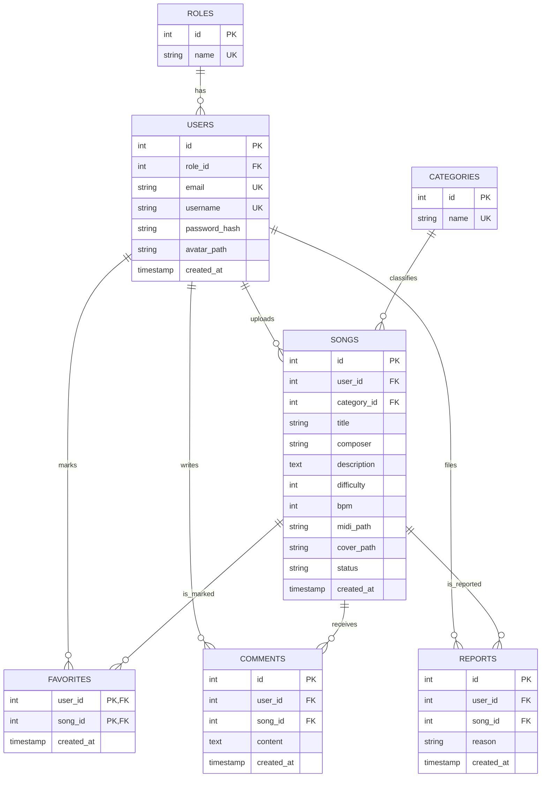

# MIDIWarrior

Aplikacja webowa do nauki gry na pianinie: użytkownicy wrzucają własne utwory MIDI i odtwarzają je w odtwarzaczu ze spadającymi nutami (coś pomiędzy MuseScore a Synthesią).

> Status: wersja wstępna. Sekcje oznaczone **TODO** zostaną uzupełnione w trakcie prac.

## Autorzy i zakres odpowiedzialności

| Autor | Zakres |
|---|---|
| TODO imię i nazwisko | TODO (np. backend, baza, frontend, odtwarzacz) |

## Opis problemu i główne funkcje

Osoby uczące się gry na pianinie nie mają prostego miejsca, w którym mogłyby wymieniać się własnymi aranżacjami i od razu je ćwiczyć. KeyFall łączy bibliotekę utworów tworzoną przez społeczność z odtwarzaczem w przeglądarce.

Planowane funkcje:

- rejestracja, logowanie i wylogowanie, role `USER` i `ADMIN`,
- przeglądanie utworów z wyszukiwarką, filtrami i paginacją,
- strona utworu z odtwarzaczem (spadające nuty, Start/Pauza/Restart, tempo),
- dodawanie, edycja i usuwanie własnych utworów (plik MIDI + okładka),
- ulubione, polubienia i komentarze,
- zgłaszanie utworów i moderacja przez administratora,
- język polski i angielski, motyw jasny i ciemny.

Główny proces do demo: rejestracja -> dodanie utworu -> moderacja przez admina -> odtworzenie utworu -> ulubione.

## Zrzuty ekranu

**TODO** (co najmniej 5 widoków mobilnych i 5 webowych, z działającej aplikacji, nie z prototypu).

| Widok | Web | Mobile |
|---|---|---|
| Logowanie / rejestracja | TODO | TODO |
| Lista utworów | TODO | TODO |
| Strona utworu z odtwarzaczem | TODO | TODO |
| Dodawanie utworu | TODO | TODO |
| Profil użytkownika | TODO | TODO |
| Panel admina | TODO | TODO |

## Architektura

Aplikacja w PHP 8.3 w układzie MVC. Żądanie przechodzi przez następujące warstwy:

```
Przeglądarka
   |
nginx -> public/index.php (front controller)
   |
Routing (dopasowanie metody HTTP i adresu)
   |
Controller (AppController i kontrolery potomne)
   |
Service / Repository (planowane: reguły i SQL)
   |
PostgreSQL
   |
View (public/views/*.php) -> odpowiedź HTML / JSON
```

Zasady podziału odpowiedzialności:

- kontrolery są cienkie: odczytują żądanie, wywołują logikę i renderują widok,
- całe SQL trafi do repozytoriów (zapytania parametryzowane PDO),
- widoki tylko wyświetlają dane i korzystają ze wspólnego `layout/header.php` i `layout/footer.php`.

### Struktura projektu

```
wdpai_project/
├── docker-compose.yaml
├── docker/            db/, nginx/, php/ (Dockerfile i konfiguracja)
├── public/
│   ├── index.php      front controller i rejestracja tras
│   ├── css/style.css  wspólne style
│   └── views/         layout/, home, login, songs, song, upload, profile, admin, 404, bad-request
└── src/
    ├── Routing.php
    └── controllers/   AppController, DefaultController, SongController, PageController
```

## Diagram ERD bazy danych

Wstępny schemat (do aktualizacji razem z `database/schema.sql`).



## Routing / endpointy

| Metoda | Adres | Kontroler | Opis | Status |
|---|---|---|---|---|
| GET | `/` | `DefaultController` | strona główna | TODO potwierdzić |
| GET | `/songs` | `SongController::index` | lista utworów, opcjonalnie `?q=`, `?difficulty=` | TODO potwierdzić |
| GET | `/song/{id}` | `SongController::show` | szczegóły i odtwarzacz; złe id -> 400, brak -> 404 | TODO potwierdzić |
| GET | `/login` | `PageController` | logowanie i rejestracja | TODO potwierdzić |
| GET | `/upload` | `PageController` | formularz dodawania utworu | TODO potwierdzić |
| GET | `/profile` | `PageController` | profil użytkownika | TODO potwierdzić |
| GET | `/admin` | `PageController` | panel admina | TODO potwierdzić |
| * | inne adresy | `DefaultController` | widok 404 z kodem 404 | TODO potwierdzić |

## Uruchomienie przez Docker

Wymagania: Docker i Docker Compose, Git.

```bash
git clone <adres-repozytorium>
cd wdpai_project
cp .env.example .env        # uzupełnij wartości
docker compose up --build
```

Aplikacja jest dostępna pod `http://localhost:8080`.

Zatrzymanie: `docker compose down` (dane bazy zostają w wolumenie), a z czyszczeniem danych: `docker compose down -v`.

## Zmienne środowiskowe

Wzór znajduje się w `.env.example`. Nie commituj pliku `.env`.

| Zmienna | Opis | Przykład |
|---|---|---|
| `DB_HOST` | nazwa usługi bazy w Docker Compose | `db` |
| `DB_PORT` | port PostgreSQL | `5432` |
| `DB_NAME` | nazwa bazy | `keyfall` |
| `DB_USER` | użytkownik bazy | `keyfall` |
| `DB_PASSWORD` | hasło bazy | TODO |
| `SMTP_HOST` | serwer SMTP (lokalnie Mailpit) | `mailpit` |
| `SMTP_PORT` | port SMTP | `1025` |

TODO: zsynchronizować tabelę z faktycznym `.env.example`.

## Import bazy i dane demonstracyjne

TODO: plik `database/schema.sql` z schematem i przykładowymi danymi.

Konta demonstracyjne (TODO po dodaniu logowania):

| Rola | E-mail | Hasło |
|---|---|---|
| USER | TODO | TODO |
| ADMIN | TODO | TODO |

## Testy

TODO: testy jednostkowe PHPUnit.

```bash
docker compose exec php vendor/bin/phpunit
```

## Raport WCAG

TODO: narzędzie (Lighthouse / axe / WAVE), data, wynik, zrzut ekranu i opis naprawionych problemów.

Znane ograniczenie: odtwarzacz oparty na `<canvas>` jest z natury wizualny. Złagodzenia: sterowanie przyciskami i klawiaturą, `aria-label` dla canvasa, komunikaty w `aria-live`, obsługa `prefers-reduced-motion`.

## Security Bingo

TODO: tabela z dowodem dla każdego zaznaczonego pola.

| Zabezpieczenie | Dowód (plik / zachowanie) |
|---|---|
| Hashowanie haseł | TODO |
| Zapytania parametryzowane | TODO |
| Walidacja danych | TODO |
| Kodowanie wyjścia (`htmlspecialchars`) | TODO |
| Autoryzacja po stronie serwera | TODO |
| Ochrona formularzy (CSRF) | TODO |
| Bezpieczny upload | TODO |

## Zadanie CRON i wysyłka e-mail

TODO: opis zadania cyklicznego (harmonogram, polecenie, sposób testowania, log) oraz wysyłki e-mail przez PHPMailer (lokalnie Mailpit).

## Deploy

TODO: link do wdrożonej aplikacji i krótki opis wdrożenia (hosting, baza, uploady, zmienne środowiskowe).
